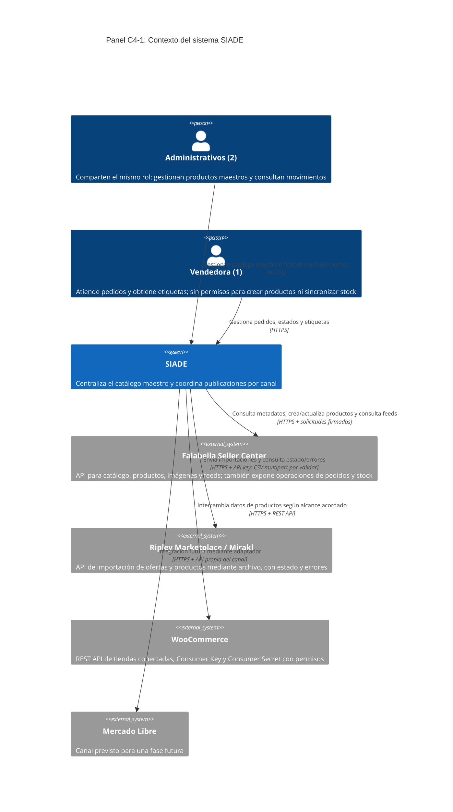
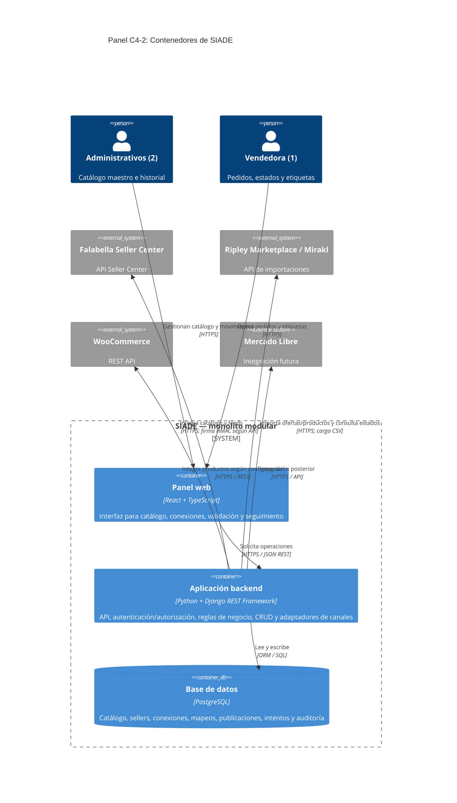

# Arquitectura C4 de SIADE

**Versión:** 1.0  
**Fecha:** 14 de noviembre de 2026  
**Estado:** propuesta para el MVP; decisiones pendientes señaladas al final.

Este documento representa SIADE mediante los paneles C4 de **contexto**, **contenedores** y **componentes**. El diseño acordado es un monolito modular con Python, Django REST Framework, PostgreSQL y React + TypeScript.

## Panel 1 — Contexto del sistema

Muestra quién usa SIADE y con qué sistemas externos intercambia información. Los canales son sistemas externos, no usuarios humanos.



## Panel 2 — Contenedores

Muestra las aplicaciones y almacenes desplegables. El backend es un solo contenedor/aplicación desplegable con módulos internos; no se propone una arquitectura de microservicios.



**Nota de despliegue:** React puede servirse por separado o desde infraestructura coordinada con Django; la topología de despliegue no está decidida. PostgreSQL es el único almacén confirmado. La tecnología para colas/worker y el gestor de secretos quedan pendientes; no aparecen como contenedores comprometidos en este panel.

## Panel 3 — Componentes del backend

Los componentes representan módulos lógicos dentro de la misma aplicación Django. Los adaptadores dependen de contratos internos; los servicios de aplicación no deben acoplarse directamente a los detalles de cada API.

```mermaid
C4Component
    title Panel C4-3: Componentes de la aplicación backend

    Container_Boundary(api, "Aplicación backend — Django + DRF") {
        Component(rest, "API REST / Views", "Django REST Framework", "Expone endpoints y traduce solicitudes HTTP a casos de uso")
        Component(auth, "Identidad y permisos", "Django Auth / DRF permissions", "Autentica usuarios y limita acceso por seller/rol")
        Component(catalog, "Servicio de catálogo", "Módulo Django", "CRUD de productos/variantes y validaciones maestras")
        Component(accounts, "Servicio de cuentas", "Módulo Django", "CRUD de sellers, conexiones de canal y referencias de credenciales protegidas")
        Component(mapping, "Mapeos de canal", "Módulo Django", "Mapea categorías, marcas, atributos y valores")
        Component(publication, "Servicio de publicaciones", "Módulo Django", "Orquesta validar, enviar, registrar estado, errores y reintentos permitidos")
        Component(orders, "Servicio de pedidos", "Módulo Django", "Consulta pedidos/ítems y aplica cambios de estado autorizados")
        Component(shipping, "Servicio de etiquetas", "Módulo Django", "Solicita y recupera etiquetas disponibles por canal")
        Component(movements, "Registro de movimientos", "Módulo Django", "Registra cambios de productos, actores, fechas y valores relevantes")
        Component(ports, "Contratos de integración", "Interfaces Python", "Define capacidades comunes: metadatos, publicar, consultar estado y errores")
        Component(falabellaAdapter, "Adaptador Falabella", "Módulo Python", "Firma solicitudes; convierte formatos; gestiona productos, imágenes y feeds")
        Component(ripleyAdapter, "Adaptador Ripley", "Módulo Python", "Prepara importación CSV y consulta estado/reporte de errores")
        Component(wooAdapter, "Adaptador WooCommerce", "Módulo Python", "Usa REST API y credenciales por tienda con permisos configurados")
        Component(mlAdapter, "Adaptador Mercado Libre", "Módulo futuro", "Se implementará cuando se defina su alcance y se valide su API")
        Component(audit, "Auditoría y errores", "Módulo Django", "Registra cambios/resultados sin guardar secretos en claro")
        ComponentDb(repo, "Repositorios / ORM", "Django ORM", "Persistencia de entidades de negocio en PostgreSQL")
    }

    System_Ext(falabella, "API Falabella Seller Center")
    System_Ext(ripley, "API Ripley / Mirakl")
    System_Ext(woo, "REST API WooCommerce")
    System_Ext(ml, "API Mercado Libre — futura")

    Rel(rest, auth, "Aplica autenticación y permisos")
    Rel(rest, catalog, "Invoca casos de uso")
    Rel(rest, accounts, "Invoca casos de uso")
    Rel(rest, publication, "Invoca casos de uso")
    Rel(rest, orders, "Invoca consulta y cambio de estado")
    Rel(rest, shipping, "Invoca obtención de etiqueta")
    Rel(catalog, mapping, "Consulta mapeos para validar")
    Rel(publication, catalog, "Obtiene producto validado")
    Rel(catalog, movements, "Registra cambios de producto")
    Rel(publication, accounts, "Obtiene cuenta y referencia al secreto")
    Rel(publication, mapping, "Obtiene mapeos de destino")
    Rel(publication, ports, "Usa contratos")
    Rel(falabellaAdapter, ports, "Implementa capacidades")
    Rel(ripleyAdapter, ports, "Implementa capacidades")
    Rel(wooAdapter, ports, "Implementa capacidades")
    Rel(mlAdapter, ports, "Implementará capacidades")
    Rel(falabellaAdapter, falabella, "HTTPS")
    Rel(ripleyAdapter, ripley, "HTTPS")
    Rel(wooAdapter, woo, "HTTPS")
    Rel(mlAdapter, ml, "HTTPS")
    Rel(catalog, repo, "Lee/escribe")
    Rel(accounts, repo, "Lee/escribe")
    Rel(mapping, repo, "Lee/escribe")
    Rel(publication, repo, "Lee/escribe publicaciones e intentos")
    Rel(publication, audit, "Registra resultados")
    Rel(orders, ports, "Usa capacidades de pedidos")
    Rel(shipping, ports, "Usa capacidades de documentos/etiquetas")
    Rel(orders, audit, "Registra acciones y respuestas")
    Rel(shipping, audit, "Registra solicitudes de etiqueta")
    Rel(movements, repo, "Persiste historial")
    Rel(audit, repo, "Persiste eventos sanitizados")
```



## Relación con SOLID

- **Responsabilidad única:** separar catálogo, mapeos, cuentas, orquestación, transporte, autenticación de canal y auditoría.
- **Abierto/cerrado:** un canal nuevo agrega un adaptador; no requiere insertar sus reglas en el servicio de catálogo.
- **Sustitución de Liskov:** los adaptadores cumplen contratos comunes de resultado y error; las operaciones no soportadas se expresan como capacidad ausente, no como comportamiento ficticio.
- **Segregación de interfaces:** contratos pequeños por capacidad, evitando exigir operaciones de pedidos/stock a un adaptador de publicación de catálogo.
- **Inversión de dependencias:** el caso de uso de publicación depende de contratos, no de clases concretas Falabella/Ripley/WooCommerce.

## CRUD e interacción por rol

Los dos usuarios administrativos tienen un único rol compartido: pueden crear, consultar, actualizar y archivar productos maestros, y consultar el registro de movimientos. La vendedora consulta/atiende pedidos, cambia estados mediante operaciones permitidas y obtiene etiquetas generadas por la plataforma seller; no puede crear productos ni sincronizar stock. Los permisos se asignan por rol y las acciones sensibles quedan registradas. La baja local preserva historiales; el borrado remoto en marketplace es una acción distinta, explícita y limitada por las reglas del canal.

CRUD inicial propuesto para recursos principales:

- `GET/POST /api/products`, `GET/PATCH/DELETE /api/products/{id}` — `DELETE` realiza archivado lógico.
- `GET/POST /api/products/{id}/variants`, `GET/PATCH/DELETE /api/variants/{id}` — baja lógica cuando haya referencias.
- `GET/POST /api/channel-accounts`, `GET/PATCH/DELETE /api/channel-accounts/{id}` — eliminación/desconexión local revoca el secreto local, conserva auditoría y no elimina recursos externos.
- `GET/POST /api/channel-mappings`, `GET/PATCH/DELETE /api/channel-mappings/{id}` — borrar físicamente solo si no está referenciado.
- `GET/POST /api/publications`, `GET /api/publications/{id}` — estados derivados de la integración; no editar libremente ni borrar operaciones ya ejecutadas.
- `GET /api/orders`, `GET /api/orders/{id}`, `PATCH /api/orders/{id}/status` — consulta y transición permitida por canal; no editar arbitrariamente el estado remoto.
- `POST /api/orders/{id}/shipping-label` y `GET /api/orders/{id}/shipping-label` — solicitar/recuperar etiqueta solo donde la API o plataforma lo habilite.
- `GET /api/products/{id}/movements` — consulta del historial de movimientos, restringida por rol.

Las rutas son propuestas de contrato REST para diseño; aún no son endpoints implementados. Toda operación deberá aplicar autorización por seller y validación del lado servidor.

## Panel 4 — Código (nivel de diseño)

El nivel C4 de código se deja a nivel de paquetes/clases orientativo; se concretará cuando se inicie la implementación para evitar documentar clases inexistentes.

```text
backend/
  accounts/       Seller, ChannelAccount, permisos, referencia de secreto
  catalog/        Product, Variant, ProductAttribute, validadores
  channel_mapping/CategoryMapping, AttributeMapping
  publications/   Publication, PublicationAttempt, casos de uso/orquestador
  integrations/
    contracts/    Protocolos/interfaces por capacidad y DTOs comunes
    falabella/    cliente firmado, serializadores, feeds
    ripley/       cliente Mirakl, constructor multipart CSV, estado/errores
    woocommerce/  cliente REST y autenticación de tienda
    mercadolibre/ futuro
  audit/          eventos sanitizados
frontend/
  React + TypeScript: catálogo, ficha, cuentas de canal, mapeos,
  publicaciones y resultados
```

## Normalización y reconciliación de catálogo

El gestor de productos centraliza el maestro. Para el caso inicial de calzado se propone estructurar tipo/categoría, plataforma (sí/no/no aplica) y presencia/tipo de taco (sin taco/con taco/no aplica); los valores y atributos adicionales se validan con el responsable de catálogo. Talla/color deben relacionarse con variantes y SKU.

Registrar movimientos de alta, edición, archivado y sincronización con actor, hora, producto, acción y resumen de campos; historial de consulta, sin edición o borrado desde UI.

La diferencia entre productos de Saga/Falabella y Ripley genera un flujo de reconciliación prioritaria: identificar, emparejar por identificador confiable, revisar faltantes/diferencias y aprobar antes de una eventual publicación a Ripley. No inferir equivalencia por nombre ni cambiar stock. El envío real queda sujeto a APIs/permisos verificados.

## Decisiones pendientes

1. Confirmar matriz detallada de permisos de los dos administrativos y de la vendedora.
2. Definir si WooCommerce será fuente, destino o ambos para datos de producto; validar pedidos, transiciones y disponibilidad de etiquetas.
3. Validar endpoints de pedidos y etiquetas de Falabella y Ripley, diferencias por estado logístico y datos requeridos.
4. Validar endpoints, columnas CSV, autenticación y ambiente de prueba de Ripley.
5. Definir en qué ambiente se desplegará, cómo se gestionarán secretos/cifrado y copias de seguridad.
6. Decidir worker/cola solo después de confirmar duración, volumen y reintentos de feeds, pedidos y etiquetas.
7. Stock sigue fuera del alcance prioritario hasta que se acuerde expresamente.
