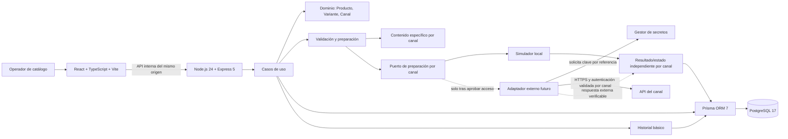

# Arquitectura y propuesta tecnológica — SIADE

**ID:** D13 · **Versión:** 0.3 · **Fecha:** 12 de noviembre de 2026  
**Estado:** propuesta concreta para el MVP, pendiente de aprobación del tutor y de las políticas de FARWEST. Las opciones se recomiendan para la práctica; no significan que la empresa haya aprobado una plataforma, una nube o una integración. Esta versión incorpora que, según informó Jordan, la conexión de sellers utiliza API keys; el método y permisos exactos deben validarse por canal.

## 1. Propósito

Definir una ruta tecnológica viable para iniciar el catálogo maestro y dejarlo preparado para variantes y canales durante las semanas restantes del proyecto. La propuesta supone una aplicación web de alcance académico, construida por un practicante, con demostración basada en datos ficticios o autorizados.

La matriz D09 confirma documentación pública de marketplaces, pero no acceso de FARWEST. En particular, la documentación de Falabella describe operaciones de producción y creación de productos mediante feeds asíncronos; por ello, el MVP empieza con preparación local/simulada. La decisión sobre conectores queda diferida hasta confirmar cuenta, documentación y permisos. Véase [Matriz_Investigacion_Integraciones_Canales.md](Matriz_Investigacion_Integraciones_Canales.md).

## 2. Alcance y decisión recomendada

Para el MVP se recomienda un **monolito modular web**: una interfaz React, un backend Node.js y una base PostgreSQL. El frontend y el backend se separan por carpetas y responsabilidades, pero se despliegan como una sola aplicación para reducir configuración y fallas operativas.

| Área | Tecnología recomendada | Motivo para este proyecto |
|---|---|---|
| Interfaz | React + TypeScript + Vite | Permite convertir el prototipo HTML en pantallas reutilizables y generar archivos estáticos para el despliegue. |
| Backend | Node.js 24 LTS + TypeScript + Express 5 | Una API interna pequeña para catálogo y validación, con el mismo lenguaje que la interfaz. Se evita sumar un framework de servidor más grande. |
| Base de datos | PostgreSQL 17 | El modelo tiene relaciones claras entre productos, variantes, canales, contenido y preparaciones; se necesitan claves y restricciones de integridad. |
| Acceso y migraciones | Prisma ORM 7.x, fijando la versión en el archivo de dependencias | Mantiene el modelo y sus migraciones en el repositorio. Se recomienda la versión estable 7; Prisma ORM 8 aún figura como candidata de lanzamiento en la documentación consultada. |
| Desarrollo local | Node.js + Docker Compose para PostgreSQL | Permite construir y probar sin contratar servicios ni enviar datos a internet. Si Docker Desktop no está permitido, se instala PostgreSQL localmente. |
| Pruebas | Vitest para lógica y Supertest para API; Playwright si queda tiempo para recorridos completos | Da cobertura rápida a las reglas principales sin convertir la configuración de pruebas en otro proyecto. |
| Versionamiento y control de cambios | Git local; repositorio remoto privado institucional o GitHub solo si se autoriza | Mantiene historial y facilita revisar entregas. No subir datos reales, claves ni credenciales. |
| Integración continua | GitHub Actions opcional para instalar dependencias, revisar tipos y ejecutar validaciones/build | Automatiza controles si se autoriza el repositorio remoto; si no, ejecutar los mismos comandos localmente. |
| Publicación de demo | Local primero; opción remota portable con Docker en una plataforma aprobada. Render + PostgreSQL administrado es solo un ejemplo académico. | La presentación puede funcionar sin internet. Ningún proveedor queda fijado para producción de FARWEST. |

La recomendación se basa en la duración del MVP, no en una política tecnológica confirmada de FARWEST. Antes de fijar dependencias, el tutor debe confirmar que acepta Node.js, PostgreSQL y Docker. Si existe un stack institucional o empresarial obligatorio, ese requisito reemplaza esta propuesta.

### Alternativas consideradas

| Decisión | Recomendación | Alternativa descartada para el MVP | Razón |
|---|---|---|---|
| Estilo de sistema | Monolito modular | Microservicios, Kubernetes o colas distribuidas | Aumentan despliegues y monitoreo sin una necesidad confirmada para el volumen del proyecto. |
| Interfaz y backend | React/Vite y Express | Next.js de extremo a extremo o NestJS | La separación queda visible para el informe y usa herramientas pequeñas, conocidas y fáciles de explicar. |
| Datos | PostgreSQL relacional | MongoDB como base principal | Producto, variantes y contenidos por canal requieren relaciones, unicidad y claves foráneas. Los atributos realmente variables podrían guardarse en JSONB después de validar su origen. |
| Ejecución | Local primero | Nube obligatoria desde el primer día | La nube requiere cuentas, permisos, política de datos y un plan para gastos y disponibilidad que aún no están confirmados. |

## 3. Arquitectura lógica con tecnologías recomendadas

Como opción inicial se propone un **programa modular de una sola aplicación**, con responsabilidades separadas. Esta forma evita introducir servicios distribuidos antes de conocer el volumen, entorno y mecanismos reales; se mantiene como propuesta para contrastar con el tutor.



La línea discontinua representa una ampliación futura, no una integración confirmada. El navegador llama únicamente al backend propio. En desarrollo, Vite ejecuta la interfaz y Express la API; en la demo, Express puede servir el resultado estático de Vite y atender la API desde el mismo dominio. Sprint 1 termina en persistencia interna. Los sprints posteriores agregan variantes, contenido por canal y simulación. La documentación pública no confirma autorización de FARWEST ni la autenticación específica de sus cuentas seller.

## 4. Componentes y responsabilidades

| Componente lógico | Responsabilidad | Límite |
|---|---|---|
| Interfaz React | Buscar, ver, crear y editar la ficha; indicar errores próximos al campo. | No contiene reglas específicas de vendedores ni credenciales. |
| API Express | Recibir las operaciones internas de catálogo, validar entradas y responder a la interfaz. | No publica un contrato para terceros ni llama directamente a marketplaces. |
| Casos de uso TypeScript | Coordinar alta/edición, consulta, variantes y preparación por destino. | No dependen directamente de una API externa. |
| Dominio de catálogo | Aplicar invariantes de producto, código interno y relación con variantes. | Campos y obligatoriedad permanecen configurables hasta validar ficha piloto. |
| Contenido por canal | Guardar títulos, descripciones y atributos adaptados por destino. | No sobrescribe los datos maestros ni contenido de otros destinos. |
| Validación/preparación | Evaluar reglas disponibles, producir errores y armar un resumen. | Solo usa reglas con fuente/estado registrado; lo desconocido queda “por validar”. |
| Puerto de canal | Define la operación lógica para preparar y recuperar un resultado. | Es una interfaz conceptual; no implica contrato o endpoint existente. |
| Simulador | Entregar un resultado local explícitamente marcado “Simulado”. | Nunca muestra “Publicado”. |
| Adaptador externo | Traducir el modelo interno y autenticarse según la documentación del canal. | No asumir que todos usan la misma API key, cabecera o alcance; requiere cuenta, documentación, permisos y prueba autorizada. |
| Gestor de secretos | Entregar al adaptador la clave asociada a una referencia de cuenta seller/canal. | Solo el backend accede al secreto; la clave no se expone al navegador, base de datos, logs ni documentación. |
| Persistencia PostgreSQL/Prisma | Guardar producto, variante, contenido, preparación e historial si aplica. | Ejecutar migraciones versionadas. No guardar secretos ni datos empresariales sin permiso. |
| Historial | Registrar acción y fecha útiles para revisar cambios. | Actor solo se guarda si el entorno lo identifica; sin secretos. |

## 5. Estructura de programa recomendada

```text
siade/
├── docs/
│   ├── contexto-y-requisitos.md
│   ├── arquitectura-y-stack.md
│   └── decisiones/               # ADR-01, ADR-02…
├── frontend/
│   ├── index.html
│   └── src/
│       ├── app/                  # inicio, navegación y configuración
│       ├── components/           # controles reutilizables
│       └── features/catalogo/    # ficha, búsqueda y variantes
├── backend/
│   └── src/
│       ├── routes/               # API interna
│       ├── application/          # casos de uso
│       ├── domain/               # producto, variante y canal
│       └── infrastructure/      # Prisma y simulador
├── prisma/
│   ├── schema.prisma
│   ├── migrations/
│   └── seed.ts                   # productos ficticios de demo
├── tests/
│   ├── unit/
│   ├── api/
│   └── acceptance/
├── docker-compose.yml            # PostgreSQL local
├── Dockerfile                    # solo si se elige despliegue en contenedor
├── .env.example                  # nombres de variables, sin valores secretos
└── .gitignore                    # excluye .env, node_modules y builds
```

El frontend se desarrolla con Vite y se compila a `dist/`. En el despliegue de un solo servicio, Express sirve `dist/` y la API propia. Durante desarrollo, Vite puede redirigir las llamadas de la interfaz al servidor Express. No se debe guardar una clave real en `.env.example`, capturas, documentación, el seed ni el control de versiones.

El repositorio se gestiona con Git. Se recomienda mantenerlo local hasta confirmar que el curso/FARWEST permiten un repositorio remoto; si se autoriza uno privado, GitHub Actions puede comprobar tipos, pruebas disponibles y compilación en cada cambio. El despliegue a Render queda manual o ligado al repositorio únicamente después de autorizar la cuenta y el acceso. El flujo mínimo es: cambio local → revisión/validación → build → despliegue opcional de demo.

## 6. Límites de datos y estados

### API keys de cuentas seller

Jordan informa que los sellers se conectan mediante API keys. Se registra como requisito reportado; no confirma que Web, Saga, Ripley u otro canal utilice el mismo esquema, cabecera, permisos o ciclo de vida de clave.

- El adaptador del canal corre solo en el backend y recupera la clave desde un gestor de secretos aprobado.
- PostgreSQL guarda como máximo metadatos de la cuenta y una referencia al secreto; nunca el valor de la API key.
- El frontend, las capturas, los registros, el seed, la documentación y Git no reciben ni almacenan claves reales.
- El MVP usa simulación y valores ficticios. Una integración real requiere cuenta y permiso del titular, documentación oficial por canal, alcance mínimo, procedimiento de rotación y revocación, y prueba autorizada.
- No enviar claves en este chat. La gestión de cualquier clave real corresponde al responsable autorizado de FARWEST.

- `Producto` y `Variante` describen la fuente maestra de SIADE.
- `ContenidoCanal` guarda las adaptaciones por destino de forma independiente.
- `PreparacionCanal` registra validación y resultado sin alterar el estado de otros destinos.
- `PUBLICADO` requiere evidencia externa verificable. Una respuesta de recepción/aceptación pendiente no basta.
- Los estados iniciales pueden expresarse como `BORRADOR`, `INCOMPLETO`, `LISTO_PARA_REVISION`, `SIMULADO`, `RESULTADO_PENDIENTE`, `PUBLICADO` y `ERROR`; la lista final se confirma con el flujo real.
- Precio, stock, SKU de seller y atributos de categoría no se vuelven obligatorios comunes hasta saber su responsable y fuente.

### Tablas propuestas para PostgreSQL

| Tabla | Uso principal | Relaciones y resguardos |
|---|---|---|
| `products` | Datos maestros comunes del producto. | Código interno único para el baseline de demo. |
| `variants` | Presentaciones del producto como talla o color, cuando el caso las requiera. | Clave foránea hacia `products`; atributos requeridos por confirmar. |
| `channels` | Destinos configurados en el alcance autorizado. | No crear como hechos canales o cuentas no confirmados. |
| `channel_content` | Título, descripción y atributos adaptados por producto/variante y destino. | Separada del dato maestro; evitar que editar un canal altere otro. |
| `channel_preparations` | Fecha, validaciones y estado de cada preparación por canal. | Estados independientes; “Publicado” requiere evidencia externa verificable. |
| `audit_events` | Acción y fecha para el historial mínimo, si se incluye. | Guardar el actor solo si el entorno lo identifica sin añadir secretos. |

La propuesta mantiene los campos centrales en columnas tipadas y relaciones con claves foráneas. `JSONB` se reserva para atributos de categoría que realmente cambien por canal y solo después de acordar cómo validarlos. No se fija aún un esquema físico definitivo ni datos de FARWEST.

## 7. Entornos y despliegue

### Desarrollo y presentación

**Decisión recomendada: local primero.** Ejecutar la interfaz y la API con Node.js en la laptop, y PostgreSQL 17 en un contenedor Docker Compose con volumen local. El sistema usa un seed reproducible de productos ficticios. La presentación debe poder ejecutarse sin conexión; la base puede reconstruirse con migraciones y datos demo.

### Opción de demo remota

Como ejemplo académico, la imagen Docker puede ejecutarse en Render Web Service con PostgreSQL administrado en la misma región. Render admite despliegues Docker y conexiones internas a PostgreSQL. Los recursos gratuitos son temporales: el servicio web se suspende por inactividad y la base gratuita expira a los 30 días sin copias de seguridad. Usarlos solo para pruebas breves con datos ficticios; no alojar datos de FARWEST allí. Confirmar límites y disponibilidad antes de desplegar.

El artefacto de despliegue se plantea como una imagen Docker portable. El contenedor ejecuta Node.js/Express y sirve el frontend compilado; PostgreSQL permanece en un servicio administrado separado. El backend obtiene la conexión a la base y las referencias a secretos desde configuración segura. Esta imagen puede ejecutarse localmente o en una plataforma aprobada que acepte contenedores, sin depender de un proveedor de alojamiento específico. Mantener la base fuera del disco efímero del contenedor y no exponerla al navegador.

### Producción de FARWEST

**Pendiente:** no se propone desplegar el sistema operativo de FARWEST en cuentas personales o planes gratuitos. La empresa debe definir proveedor, región, dominio, identidad, respaldo, monitorización y responsable de operación. La práctica prepara una imagen portable y configuración externa para PostgreSQL y secretos. FARWEST define proveedor, región, dominio, identidad, respaldos, supervisión, rotación de API keys y responsable de operación.

## 8. Registro de decisiones (ADR)

| ADR | Tema | Estado actual | Decisión recomendada | Validación pendiente |
|---|---|---|---|---|
| ADR-01 | Estilo de arquitectura | Propuesto para MVP | Monolito modular, un servicio desplegable. | Confirmar que el alcance académico no exige otra plataforma. |
| ADR-02 | Interfaz | Propuesto | React + TypeScript + Vite. | Confirmar stack aceptado y disponibilidad de Node 24 en el equipo. |
| ADR-03 | Backend | Propuesto | Node.js 24 LTS + TypeScript + Express 5, API interna para la interfaz. | Confirmar restricciones del curso/FARWEST y herramientas instalables. |
| ADR-04 | Base de datos | Propuesto | PostgreSQL 17 con integridad relacional. | Confirmar si se permite Docker o instalación local y si se acepta PostgreSQL. |
| ADR-05 | Acceso a datos | Propuesto | Prisma ORM 7.x, versión fijada y migraciones en el repositorio. | Verificar compatibilidad del equipo y mantener la misma versión en desarrollo/despliegue. |
| ADR-06 | Desarrollo | Propuesto | Ejecución local; Docker Compose para Postgres; seed ficticio. | Verificar permiso y disponibilidad de Docker Desktop. |
| ADR-07 | Demo remota | Condicional | Imagen Docker + PostgreSQL administrado en una plataforma aprobada; Render es un ejemplo para demo. | Requiere autorización, cuenta, control de acceso, persistencia y respaldos; no usar planes gratuitos con datos reales. |
| ADR-08 | Producción y datos | Pendiente | Usar solo la nube o infraestructura que FARWEST defina. | Responsable, región, seguridad, costos, backup y operación confirmados por la empresa. |
| ADR-09 | API keys e identidad | Requisito reportado; solución pendiente | El backend recupera API keys desde un gestor de secretos aprobado; PostgreSQL guarda como máximo una referencia y metadatos. En el MVP se usan claves ficticias. | Confirmar dueño, alcance, mecanismo, permisos, rotación, revocación y gestor de secretos con FARWEST; nunca solicitar claves reales en el repositorio o chat. |
| ADR-10 | Canales externos | Pendiente | Puerto lógico más simulador; adaptador real solo con autenticación oficial validada para cada canal. | Confirmar canal/cuenta, tipo y alcance de API key, documentación técnica, permisos y prueba autorizada. |
| ADR-11 | Imágenes | Fuera del primer MVP | Guardar solo una URL autorizada o dejar imagen opcional; no agregar carga de archivos. | Acordar fuente y almacenamiento si la empresa exige fotos dentro del sistema. |
| ADR-12 | Código y automatización | Propuesto | Git local; remoto privado y GitHub Actions solo con autorización. | Confirmar política del curso/FARWEST antes de alojar código o automatizar despliegues. |

## 9. Consecuencias para el plan

- **Semana 12:** llevar la propuesta D13 v0.3 al tutor. Si no existe restricción, fijar Node 24, TypeScript, React/Vite, Express, PostgreSQL 17 y Prisma 7; preparar entorno local y el modelo inicial. Si alguna herramienta está prohibida, cambiar esa decisión antes de implementar persistencia.
- **Sprint 1 / semana 12:** construir búsqueda, alta y edición de catálogo en local con datos demo. No añadir conexión externa.
- **Sprint 2 / semana 13:** variantes, selección de destino y contenido por canal, conservando el límite entre maestro y canal.
- **Sprint 3 / semana 14:** reglas disponibles, errores, resumen y estados por canal con el simulador.
- **Semana 15:** pruebas de aceptación, correcciones y guía de la demo; decidir si el tiempo permite publicar una demo remota.
- **Semana 16:** presentación final con demo local como ruta principal y demo remota solo como respaldo opcional probado.

## 10. Criterios para cerrar la arquitectura del MVP

1. El tutor aprueba o cambia el stack y el tipo de entrega académica.
2. Se confirma si Node 24, Docker Desktop y PostgreSQL pueden instalarse en el equipo.
3. FARWEST define si la demostración usa datos ficticios o autoriza una ficha anonimizada.
4. FARWEST define si puede usarse una cuenta de nube personal para una demo. La respuesta inicial debe ser “no” mientras no exista autorización.
5. IT de FARWEST define el entorno productivo, identidad, backups y región antes de cualquier despliegue empresarial.
6. El responsable confirma si Web, Saga y Ripley corresponden a destinos/cuentas activos y autoriza pruebas antes de diseñar un adaptador.
7. FARWEST define quién emite y custodia cada API key, su alcance, rotación, revocación y el gestor de secretos autorizado.

## Fuentes técnicas consultadas

- React: documentación de componentes y construcción de interfaces ([React](https://react.dev/learn)).
- Vite: plantilla React/TypeScript y generación de archivos estáticos ([guía](https://vite.dev/guide/), [build de producción](https://vite.dev/guide/build)).
- Node.js: versiones LTS activas al 12/11/2026 ([ciclo de versiones](https://nodejs.org/en/about/previous-releases)).
- Express: recomendaciones de seguridad para despliegues ([guía](https://expressjs.com/en/advanced/best-practice-security/)).
- PostgreSQL: documentación del motor y tipos relacionales/JSONB ([manual](https://www.postgresql.org/docs/)).
- Prisma ORM: compatibilidad con PostgreSQL 17 y Node 24 en Prisma 7; Prisma 8 sigue como release candidate en la fecha consultada ([bases admitidas](https://www.prisma.io/docs/orm/v7/reference/supported-databases), [estado de versiones](https://www.prisma.io/docs/orm)).

- Render: despliegue Docker, conexión a PostgreSQL y límites gratuitos ([Docker](https://render.com/docs/docker), [conexiones](https://render.com/docs/postgresql-creating-connecting), [límites](https://render.com/docs/free)).

Hasta aprobarse con el tutor y FARWEST, esta versión es la recomendación técnica del proyecto. No confirma el proveedor de producción, no habilita datos comerciales reales y no confirma una integración de marketplace.
