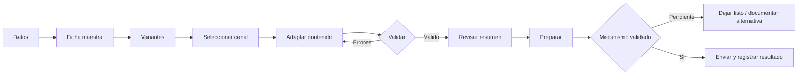
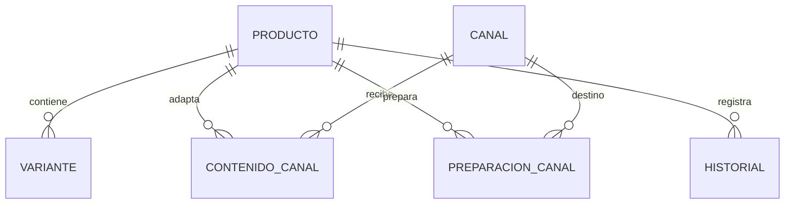

# SIADE — Documento de contexto, análisis y diseño funcional

**Versión:** 1.0, baseline de diseño del Hito 1  | **Fecha:** 7 de noviembre de 2026  
**Estado:** baseline funcional D01–D09 y propuesta técnica D13 v0.3 disponibles. El stack se recomienda para el MVP, pero requiere aprobación del tutor; la nube productiva y cualquier integración siguen abiertas.

## Cierre del Hito 1

El Hito 1 queda cerrado como **paquete documental y funcional v1.0**: contexto, alcance, requisitos, reglas, procesos, backlog, modelo conceptual, arquitectura preliminar, criterios de aceptación, prototipo y matriz de canales están reunidos y relacionados. El paquete permite preparar el Sprint 1 para el catálogo maestro. No representa una aprobación de FARWEST ni confirma entrevistas, campos oficiales por categoría o acceso a canales.

Convenciones: **Confirmado** fue indicado por el estudiante o está respaldado por una fuente citada; **Propuesto** es una decisión de diseño para el prototipo/MVP; **Pendiente** requiere confirmación o evidencia. Los valores propuestos se pueden cambiar antes de congelar el modelo físico. Los archivos de `sources/` se consideran solo lectura.

## 1. Contexto

### Confirmado

- SIADE es un proyecto de prácticas preprofesionales; debe maquetarse un producto demostrable y evidenciar el ciclo de vida del software.
- La plantilla denomina al sistema “Sistema de Integración y Automatización de Datos para E-commerce (SIADE)”; el alcance funcional de este baseline se centra en catálogo maestro y preparación multicanal.
- Empresa: FARWEST; área de práctica: Marketing y Ecommerce. Practicante: Jordan André Rodas Panaifo, código 20200285.
- La ubicación informada para FARWEST es Calle Berlín 290, Miraflores, Lima; la modalidad de práctica indicada es remota. Incorporar misión, visión, organigrama y servicios solo desde un brochure o fuente institucional autorizado.
- El Hito 1 se cerró en la semana 11; el corte actual del plan es la semana 12 y la exposición final corresponde a la semana 16.
- Saga y Ripley fueron explorados preliminarmente como posibles canales integrables. El profesor espera investigación para sustentar la propuesta tecnológica.
- El MVP prioriza la gestión centralizada de productos y publicación/preparación en Web, Saga y Ripley.
- Pedidos y restock son complementarios. Se excluyen despacho físico, facturación/boleteo y tickets de soporte.
- Se propone Design Thinking para investigar y diseñar, y Scrum con Sprints para construir incrementos.

### Hipótesis

La creación multicanal puede duplicar captura y adaptación de datos, con riesgo de inconsistencias y retrabajo. Debe comprobarse observando el proceso y entrevistando a sus participantes. La investigación sobre calidad de información de producto en comercio electrónico identifica la integridad y presentación de esa información como aspectos que influyen en la experiencia de compra; esto sustenta priorizar una ficha consistente, pero no demuestra un problema medido en FARWEST (Amsl et al., 2023). Marketing e IT son actores potenciales mencionados en el análisis previo, no roles formalmente confirmados.

### Problema provisional

La preparación de productos para canales diferentes puede requerir repetir y adaptar información en distintos lugares. Sin una fuente maestra ni validaciones visibles, aumenta el riesgo de inconsistencias y esfuerzo manual. No hay métricas aún.

### Objetivo general

Diseñar y construir un MVP demostrable que centralice datos de productos y apoye su preparación multicanal, dejando el mecanismo de publicación sujeto a investigación y validación.

## 2. Alcance

**MVP:** catálogo central; crear/editar productos; variantes; contenido común y específico por canal; selección Web/Saga/Ripley; validaciones por canal; resumen previo; estados independientes de preparación y resultado; trazabilidad básica propuesta.

**Complementario, posterior al núcleo:** pedidos, consulta de stock/alertas, recomendaciones inteligentes de restock.

**Excluido:** despacho físico, facturación o boleteo, tickets de soporte.

**Propuesta técnica para el MVP:** React + TypeScript + Vite, Node.js 24 LTS + Express 5, PostgreSQL 17 + Prisma ORM 7, con desarrollo local primero. D13 detalla la arquitectura, la estructura del programa y la opción de demo en nube. Tutor/FARWEST aún deben aprobar herramientas y política de datos. La documentación consultada muestra operaciones públicas de catálogo para marketplaces, pero no confirma acceso ni autorización para FARWEST. La correspondencia entre “Saga” y Falabella, y la plataforma del canal Web, siguen pendientes. Ver la [matriz de investigación](Matriz_Investigacion_Integraciones_Canales.md).

## 3. Usuarios y ciclo de vida

| Actor | Estado | Interés |
|---|---|---|
| Operador de catálogo/Marketing | Hipótesis | Crear ficha y adaptar contenido. |
| Revisor de catálogo | Hipótesis | Validar información antes de prepararla. |
| IT/responsable técnico | Área potencial mencionada | Investigar mecanismo autorizado y operación técnica. |
| Web, Saga, Ripley | Canales objetivo confirmados | Destinos; requisitos y capacidades pendientes. |

Design Thinking: Empatizar (entrevista/observación), Definir, Idear, Prototipar y Testear; las entrevistas y observaciones aún deben registrarse cuando ocurran. La investigación académica sobre su integración en ingeniería de requisitos respalda combinar la comprensión centrada en usuarios con el refinamiento de requisitos, y también advierte que las técnicas deben adaptarse al contexto (Martins et al., 2019; Hehn et al., 2020). Scrum organiza el desarrollo incremental de acuerdo con su guía oficial (Schwaber & Sutherland, 2020). Para ajustarse al calendario de recuperación, el plan propone Sprints de una semana en las semanas 12, 13 y 14, seguidos por estabilización y aceptación en la semana 15. Es un ritmo comprimido: capacidad y alcance se revisan al inicio de cada Sprint; no se asume una velocidad previa.

Evidencia SDLC esperada: contexto, análisis, diseño, incrementos, pruebas, guía de despliegue, demostración/piloto autorizado y propuesta de mantenimiento. Producción real depende de entorno y autorización; si no existe, documentar simulación claramente.

## 4. Requerimientos funcionales

Los campos mínimos exactos son un **baseline propuesto para demostración**, no requisitos aprobados por FARWEST. En Sprint 1 se parte de código interno y nombre maestro; marca, categoría, descripción y referencias a recursos quedan editables/optativas hasta revisar una ficha real anonimizada. Precio, stock y atributos por categoría no se vuelven obligatorios hasta confirmar su fuente y reglas.

| ID | Requerimiento | Prioridad | Criterio verificable |
|---|---|---|---|
| RF-01 | Listar, buscar y abrir productos por código interno o nombre. | Must · S1 | La búsqueda muestra el producto coincidente y permite abrir su ficha; sin resultados muestra un estado vacío entendible. |
| RF-02 | Crear y editar ficha maestra con identificador interno único. | Must · S1 | Código y nombre son requeridos en la demo; un código duplicado se rechaza; al reabrir se observan los cambios en el entorno acordado. |
| RF-03 | Asociar variantes al producto, sin imponer atributos no confirmados. | Must · S2 | Cada variante pertenece a una ficha; se distinguen SKU/código de variante y atributos solo cuando hayan sido acordados. |
| RF-04 | Seleccionar los canales objetivo individualmente por producto. | Must · S2 | La selección de Web, Saga o Ripley queda representada por destino; el nombre Saga/Falabella permanece pendiente de homologación. |
| RF-05 | Mantener contenido específico de canal separado del dato maestro. | Must · S2 | Cambiar título/descripción de un canal no altera el maestro ni el contenido de otro canal. |
| RF-06 | Validar campos aplicables y mostrar errores accionables por canal. | Must · S3 | El error identifica canal y campo, explica qué falta y bloquea solo la preparación afectada. La matriz de reglas se configura con evidencia vigente. |
| RF-07 | Mostrar resumen de contenido y validación antes de preparar. | Should · S3 | El resumen coincide con los datos guardados para el canal elegido. |
| RF-08 | Mantener estado independiente por canal y registrar el resultado disponible. | Must · S3 | Una falla no cambia otros canales; “Publicado” requiere evidencia externa; la demo diferencia borrador, listo, simulación y resultado externo. |
| RF-09 | Registrar historial básico de cambios relevantes. | Should · S3/estabilización | Si se implementa, registra actor disponible, acción, fecha y producto sin guardar secretos. |
| RF-10 | Generar archivo, llamada o integración según mecanismo autorizado. | Condicional · fuera de S1–S3 | Solo se agrega cuando FARWEST confirme canal/cuenta, mecanismo, permisos, documentación y pruebas permitidas. |
| RF-11 | Consultar pedidos. | Could · posterior | Fuera del camino crítico del Hito 1/MVP de catálogo. |
| RF-12 | Recomendar reposición/restock. | Could · posterior | Depende de fuente, reglas y datos aún no confirmados; fuera del camino crítico. |

## 5. Requerimientos no funcionales iniciales

| ID | Requerimiento | Criterio para esta entrega |
|---|---|---|
| RNF-01 Usabilidad | Lenguaje claro, navegación consistente y errores junto al campo afectado. | Se observa en una prueba guiada del prototipo; medir con usuarios sigue pendiente. |
| RNF-02 Integridad | Código maestro único, relación variante-producto íntegra y contenido separado por canal. | Verificar con los casos CP-01–CP-06. |
| RNF-03 Trazabilidad | Guardar cambios/resultados relevantes si el alcance y entorno lo permiten. | No almacenar claves; explicar cuando la identidad real del actor no esté disponible en demo. |
| RNF-04 Seguridad | Autenticación y permisos conforme a la política del entorno aprobado. | No incluir credenciales, tokens o datos comerciales restringidos en código, prototipo, capturas o informe. |
| RNF-05 Resiliencia | El error de un canal no modifica los demás estados. | Verificar con CP-09; no requiere integración real para probar estados simulados. |
| RNF-06 Mantenibilidad | Mantener separados datos maestros, contenido de canal y preparación/resultado. | Criterio lógico; la arquitectura física queda pendiente del stack autorizado y la investigación. |
| RNF-07 Compatibilidad/rendimiento | Compatibilidad, capacidad y tiempos medibles. | Umbrales y dispositivos no se inventan; definir con tutor si son necesarios para la evaluación. |

## 6. Reglas de negocio propuestas

| ID | Regla | Clasificación/nota |
|---|---|---|
| RN-01 | El código interno identifica un producto de forma única dentro de SIADE. | Propuesta para el baseline de demostración; confirmar cómo se identifica en FARWEST. |
| RN-02 | Código interno y nombre maestro son obligatorios para crear un registro en la demo. | Propuesta acotada a S1, no equivale a la ficha oficial de la empresa. |
| RN-03 | Una variante pertenece a un solo producto; un producto puede tener cero o varias variantes. | Atributos/identificadores de variante se confirman con producto piloto. |
| RN-04 | El contenido adaptado de un canal no sobrescribe el dato maestro ni el contenido de otro canal. | Regla funcional del MVP. |
| RN-05 | Cada canal mantiene preparación/resultado independiente. | Regla funcional del MVP. |
| RN-06 | Un canal solo se muestra como preparado cuando sus reglas configuradas se cumplen. | Las reglas por canal requieren evidencia oficial o confirmación FARWEST. |
| RN-07 | “Publicado” se reserva para un resultado externo verificable; el mock debe decir “simulado”. | No marcar como publicado por una respuesta local o un envío solo aceptado. |
| RN-08 | Precio, stock, imágenes y campos de categoría no se consideran obligatorios comunes hasta confirmar responsable y fuente de verdad. | Pendiente de validación. |
| RN-09 | Los campos requeridos por canal no se fijan en código hasta verificar la categoría y documentación vigentes. | Falabella documenta atributos por categoría y procesamiento asíncrono; revisar la matriz D09. |
| RN-10 | Pedidos/restock son complementarios; despacho físico, facturación/boleteo y tickets de soporte quedan excluidos. | Alcance del proyecto indicado por el estudiante. |

## 7. Procesos AS-IS / TO-BE

**AS-IS provisional (hipótesis por confirmar):** recopilar información → completar ficha/plantilla → adaptar por canal → ingresar o cargar en cada destino → atender errores → comprobar publicación en fuentes posiblemente separadas. Riesgos posibles: captura repetida, desalineación de versiones, errores de formato y poca visibilidad; sin métricas confirmadas.

**TO-BE propuesto:** ficha maestra → variantes/recursos → seleccionar canales → completar contenido específico → validar → corregir errores → revisar resumen → preparar mediante mecanismo autorizado validado → guardar resultado/estado por canal y permitir reintento controlado.

## 8. Product Backlog y plan de Sprints

El orden está priorizado por valor y dependencia. Los puntos son estimaciones relativas iniciales, no una velocidad comprometida. El calendario exige Sprints acelerados de una semana; reducir historias si la capacidad no alcanza. La integración real no es prerrequisito para construir catálogo, variantes y simulación.

| ID | Historia de usuario | Prioridad | Puntos | Criterio de aceptación |
|---|---|---:|---:|---|
| US-01 | Como operador, quiero buscar productos para localizar una ficha. | P0 · S1 | 3 | Buscar por código/nombre; abrir resultado; mostrar estado vacío si no hay coincidencias. |
| US-02 | Como operador, quiero crear y editar la ficha maestra. | P0 · S1 | 5 | Exigir código y nombre para la demo; impedir duplicado; volver a abrir y comprobar cambios en el entorno acordado. |
| US-03 | Como operador, quiero asociar variantes al producto. | P0 · S2 | 5 | Agregar/editar/quitar una variante sin separarla de su producto; no imponer atributos no confirmados. |
| US-04 | Como operador, quiero seleccionar destinos de canal por producto. | P0 · S2 | 3 | Guardar selección independiente de Web, Saga y Ripley como etiquetas configurables; sin afirmar conexión. |
| US-05 | Como operador, quiero mantener contenido distinto por canal sin alterar el maestro. | P0 · S2 | 5 | Modificar el título o descripción de un destino y comprobar que el maestro y otros destinos siguen iguales. |
| US-06 | Como operador, quiero detectar datos faltantes antes de preparar un canal. | P0 · S3 | 5 | Mostrar canal, campo y corrección; bloquear solo ese destino. La lista de campos se basa en reglas confirmadas/configuradas. |
| US-07 | Como revisor, quiero revisar un resumen antes de preparar el contenido. | P1 · S3 | 3 | Mostrar valores y errores del canal escogido tal como están guardados. |
| US-08 | Como operador, quiero conocer el estado por canal sin confundir simulación y publicación. | P0 · S3 | 3 | Mostrar estados independientes; “Publicado” solo con evidencia externa; demo indica “Simulado”. |
| US-09 | Como responsable, quiero consultar cambios recientes de una ficha. | P1 · estabilización | 3 | Mostrar acción/fecha y actor disponible, si el entorno permite identificarlo. |
| US-10 | Como operador, quiero generar una salida compatible con un mecanismo autorizado. | Condicional | 8+ | Solo tras confirmar canal/cuenta, documentación, permisos y condiciones de prueba. |
| US-11 | Como responsable, quiero consultar pedidos. | P2 · posterior | 8 | Fuente y alcance por definir. |
| US-12 | Como responsable, quiero ver sugerencias de restock. | P2 · posterior | 8+ | Fuente, historial y reglas por validar. |

### Plan de ejecución alineado al cronograma

| Iteración | Objetivo | Historias | Evidencia de salida |
|---|---|---|---|
| Sprint 0 · Hito 1, semana 11 | Cerrar baseline funcional y lógico, dejar Sprint 1 acotado y registrar pendientes. | D01–D09, D13 | Este documento, D13, guía, prototipo, matriz y Excel de cronograma listos. |
| Sprint 1 · semana 12 | Presentar la propuesta técnica D13 v0.3 al tutor; después, construir el catálogo interno demostrable, sin conexión externa. | D13 v0.3; US-01, US-02 | Aprobar o ajustar stack, estructura, persistencia y entorno; luego demostrar búsqueda/alta/edición con datos ficticios/autorizados. |
| Sprint 2 · semana 13 | Variantes y contenido separado por canal. | US-03, US-04, US-05 | Ficha con variantes; destinos configurables; contenido aislado del maestro. |
| Sprint 3 · semana 14 | Validaciones, resumen y estado independiente. | US-06, US-07, US-08 | Demo reproducible con validación y simulación claramente rotulada. |
| Semana 15 · estabilización | Ejecutar pruebas, corregir defectos críticos y preparar guía/demo. | US-09 si cabe; D08/D11/D12 | Resultados registrados; historial opcional; documentación y ensayo. |

**Definition of Ready:** historia priorizada, ejemplo de datos autorizado o ficticio, criterio comprobable, dependencia identificada y entorno/stack permitido. La revisión de D13 v0.3 es la puerta técnica inicial de la semana 12. **Definition of Done:** criterio demostrado, errores principales gestionados, revisión registrada, evidencia guardada y simulación rotulada. No se exige terminar una integración para completar Sprint 1.

## 9. Modelo conceptual de datos

El modelo separa el dato maestro de las adaptaciones por destino y del resultado de preparación. Es lógico: no fija motor, tipo físico, API ni plataforma. Los campos con “propuesto” se revisan con una ficha anonimizada; precio y stock no son obligatorios en el Sprint 1.

| Entidad | Atributos conceptuales | Reglas/relaciones |
|---|---|---|
| Producto | product_id; internal_code; master_name; brand?; base_description?; category?; resource_refs?; lifecycle_status; created_at; updated_at | internal_code único en SIADE; 1:N Variantes, ContenidoCanal, PreparacionCanal e Historial. |
| Variante | variant_id; product_id; variant_code/SKU?; attributes (clave/valor); price?; stock? | N:1 Producto; SKU, atributos, precio y stock dependen de confirmación y fuente. |
| Canal | channel_id; channel_label; active_for_mvp; validation_profile_ref? | Registro de destino configurable; los nombres Web/Saga/Ripley no enlazan por sí mismos una cuenta. |
| ContenidoCanal | channel_content_id; product_id; channel_id; title?; description?; channel_attributes?; updated_at | N:1 Producto y Canal; no altera maestro ni otros canales. Posible extensión por variante tras conocer los requisitos. |
| PreparacionCanal | preparation_id; product_id; channel_id; state; validation_summary; result_reference?; result_at? | N:1 Producto y Canal; estado independiente. result_reference solo si un mecanismo autorizado lo devuelve. |
| Historial | history_id; product_id; actor_ref?; action; occurred_at; details? | N:1 Producto; datos mínimos y sin secretos. |

**Campos de inicio propuestos para S1:** código interno y nombre maestro requeridos para la demo; marca, categoría, descripción y referencia a imágenes optativos. **Fuera de obligatoriedad hasta validación:** precio, stock, SKU de seller, talla/color, atributos dinámicos, identificadores externos y requisitos por canal. El modelo evita almacenar contraseñas o tokens.

## 10. Arquitectura preliminar y estructura del programa

La arquitectura y estructura técnica propuesta están en [Arquitectura_Preliminar_y_Estructura_SIADE.md](Arquitectura_Preliminar_y_Estructura_SIADE.md) (D13 v0.3). Recomienda React/Vite para la interfaz, Express/Node para la API interna, PostgreSQL con Prisma y un monolito modular. Desarrollo y presentación local son la ruta principal. El despliegue remoto se plantea portable mediante Docker; Render queda como ejemplo para una demo con datos ficticios.

La propuesta no está aprobada todavía. El tutor debe confirmar el stack y el permiso para instalar Docker/PostgreSQL. FARWEST debe definir si autoriza nube, datos o publicación. No se selecciona proveedor productivo ni se confirma integración con marketplaces.

## 11. Pruebas y aceptación

Los casos son criterios para Sprint 1–3; aún no hay ejecución registrada. En pruebas de canal usar reglas documentadas y datos ficticios/autorizados. No realizar escrituras en vendedores reales como parte de esta especificación.

| Caso | Cobertura | Escenario | Resultado esperado |
|---|---|---|---|
| CP-01 | RF-02 / US-02 | Crear producto con código y nombre de demo válidos. | Se guarda y aparece en el catálogo. |
| CP-02 | RF-02 / US-02 | Crear un producto sin código o sin nombre. | Se indica el campo requerido y no se guarda como válido. |
| CP-03 | RN-01 / US-02 | Crear otro producto con el mismo código interno. | Se impide el duplicado y se conserva el producto existente. |
| CP-04 | RF-01 / US-01 | Buscar por código, nombre parcial y valor sin coincidencias. | Se muestran resultados correctos o un estado vacío; se puede abrir una ficha. |
| CP-05 | RF-02 / US-02 | Editar y volver a abrir una ficha. | Los cambios acordados permanecen en el entorno de prueba. |
| CP-06 | RF-03 / US-03 | Asociar una variante a un producto. | La variante aparece bajo su producto; no puede quedar huérfana. |
| CP-07 | RF-05 / US-05 | Editar contenido de un canal. | No cambia el maestro ni el contenido de los otros canales. |
| CP-08 | RF-06 / US-06 | Faltar un campo requerido por las reglas del canal. | Se identifica canal/campo y se bloquea solo ese destino. |
| CP-09 | RN-05 / US-08 | Un canal falla y otro pasa la validación. | Los estados quedan independientes. |
| CP-10 | RN-07 / US-08 | Preparar en modo simulado. | El estado muestra “Simulado”; nunca aparece “Publicado”. |
| CP-11 | RF-07 / US-07 | Revisar resumen previo a preparación. | Coincide con los valores guardados para ese destino. |
| CP-12 | RNF-03 / RN-04 | Revisar datos de prueba, registros y capturas. | No contienen contraseñas, tokens ni datos comerciales no autorizados. |
| CP-13 | RF-10 | No hay mecanismo/acceso autorizado para el canal. | No se intenta envío; se registra como pendiente o simulación. |

## 12. Cierre del Hito 1 y preparación del Sprint 1

### Resultado del Hito 1

**Estado: cerrado como baseline de diseño v1.0.** Se completó la consolidación interna de D01–D09 y D13, y se dejó una ruta de Sprint 1 sin dependencia de una API. “Cerrado” significa que los documentos y criterios están preparados; no significa que FARWEST los haya aprobado, que el AS-IS se haya observado ni que los canales estén conectados.

| Entregable | Estado de salida | Evidencia del paquete | Revisión que continúa en paralelo |
|---|---|---|---|
| D01 · Contexto | Baseline v1.0 | Este documento, secciones 1–2 | Validar datos institucionales y problema con tutor/FARWEST. |
| D02 · AS-IS/TO-BE | Provisional documentado | Sección 7 y hoja Diagramas del Excel | Reemplazar AS-IS hipotético con observación; validar TO-BE. |
| D03 · Requisitos/reglas | Baseline propuesto | Secciones 4–6, reglas RN-01–RN-10 | Confirmar campos y reglas de la ficha piloto. |
| D04 · Product Backlog/Scrum | Priorizado por sprint | Sección 8 y Cronograma_SIADE_Hito1_v3.xlsx | Ajustar capacidad y alcance a la tecnología aprobada. |
| D05 · Modelo conceptual | Especificado | Sección 9 y ER lógico | Refinar con datos reales anonimizados; no fijar esquema físico todavía. |
| D06 · Contexto | Incluido | Hoja Diagramas del Excel | Confirmar actores, sistemas fuente y nombres/cuentas de canales. |
| D07 · UI/UX | Prototipo de baja fidelidad | prototipo/index.html | Probar tareas y registrar observaciones cuando haya usuario. |
| D08 · Aceptación | Criterios y casos preparados | Sección 11, CP-01–CP-13 | Ejecutar durante S1–S3; resultados aún inexistentes. |
| D09 · Viabilidad de canales | Investigación pública inicial | Matriz_Investigacion_Integraciones_Canales.md | Confirmar cuenta y permisos con responsable; no hacer llamadas reales aún. |
| D13 · Arquitectura y tecnologías | Arquitectura lógica y stack recomendado en v0.2; aprobación pendiente | Arquitectura_Preliminar_y_Estructura_SIADE.md | Tutor valida/ajusta stack; FARWEST autoriza entorno y política de datos. Integraciones siguen pendientes. |

### Alcance autorizado para iniciar Sprint 1

- **Objetivo:** entregar un catálogo interno demostrable con búsqueda, alta y edición de producto.
- **Datos de la demo:** ficticios o autorizados. Código interno y nombre son obligatorios solo como baseline del prototipo; la empresa puede cambiarlos tras validar la ficha.
- **Fuera de Sprint 1:** llamadas a marketplaces, sincronización de stock/precio, credenciales, pedidos, despacho, facturación/boleteo y tickets de soporte.
- **Dependencia operativa antes del código del MVP:** presentar la propuesta D13 v0.3 y confirmar con el tutor el stack, persistencia y entorno permitidos. Si no se aprueba, cambiar la selección antes de implementar persistencia.
- **Desarrollo desacoplado:** la investigación D09 continúa en paralelo. “Simulado” y “Publicado” nunca se usan como equivalentes.

### Lista de salida / Definition of Ready

- [x] Alcance MVP, exclusiones y estados de evidencia documentados.
- [x] Historias US-01/US-02 y criterios de aceptación descritos para Sprint 1.
- [x] Modelo de producto separado del canal y de sus resultados.
- [x] Casos CP-01–CP-13 vinculados a requisitos/historias.
- [x] Arquitectura lógica, estructura candidata, stack recomendado y registro ADR documentados en D13 v0.3.
- [x] Prototipo y diagrama de contexto reunidos con el paquete.
- [ ] Confirmar con tutor qué tipo de entrega se evalúa (maqueta, MVP ejecutable o ambos).
- [ ] Obtener aprobación del tutor para stack, entorno y persistencia propuestos.
- [ ] Obtener una ficha anonimizada o autorización para datos de demostración.

Las casillas pendientes son acuerdos externos previos al código; no reabren el Hito 1 documental ni habilitan conectores reales.

## 13. Riesgos y pendientes de validación

| Tema | Próxima acción |
|---|---|
| Flujo actual y responsables | Entrevista y observación de alta real. |
| Campos por canal | Obtener guías y ficha anonimizada. |
| Saga/Ripley/Web | Investigar fuentes oficiales, permisos, operaciones, formatos, errores y límites. |
| Precio/stock | Confirmar responsable y fuente de verdad. |
| Maqueta o MVP ejecutable | Confirmar expectativa académica. |
| Fechas/capacidad de Sprint | Ajustar al calendario y horas reales. |
| Evidencia de producción | Acordar entorno autorizado o demostración simulada. |

## 14. Preguntas para la siguiente validación

1. ¿Quién crea, revisa y publica hoy un producto? ¿Qué sistemas/archivos usa?
2. ¿Cuáles son los campos obligatorios comunes y de cada canal? ¿Puede facilitarse un ejemplo anonimizado?
3. ¿SKU, talla/color, precio, stock e imágenes aplican? ¿Cuál es su fuente de verdad?
4. ¿Cómo se confirma hoy que el producto quedó publicado?
5. ¿Se espera prototipo navegable, MVP con persistencia o ambos?
6. ¿Qué duración, fechas y evidencias exige el instituto para los Sprints y el ciclo de vida?
7. ¿Quién confirma permisos y requisitos técnicos de Saga/Ripley?

## 15. Referencias base

Las referencias académicas justifican el enfoque general; no se usan para atribuir hechos internos a FARWEST. Las fuentes oficiales de canal describen capacidades públicas, no acceso de la empresa.

- Amsl, S., Watson, I., Teller, C., & Wood, S. (2023). Presenting products on websites: The importance of information quality criteria for online shoppers. *International Journal of Retail & Distribution Management, 51*(9–10), 1213–1238. https://doi.org/10.1108/IJRDM-04-2023-0266
- Hehn, J., Mendez, D., Uebernickel, F., Brenner, W., & Broy, M. (2020). On integrating design thinking for human-centered requirements engineering. *IEEE Software, 37*(2), 25–31. https://doi.org/10.1109/MS.2019.2957715
- Martins, H. F., Oliveira Junior, A. C., Canedo, E. D., Kosloski, R. A. D., Paldês, R. Á., & Oliveira, E. C. (2019). Design thinking: Challenges for software requirements elicitation. *Information, 10*(12), 371. https://doi.org/10.3390/info10120371
- Schwaber, K., & Sutherland, J. (2020). *La Guía Scrum: La guía definitiva de Scrum: Las reglas del juego*. https://scrumguides.org/docs/scrumguide/v2020/2020-Scrum-Guide-Spanish-Latin-South-American.pdf

**Control de versión:** 1.0 — baseline documental del Hito 1, con estados y decisiones abiertas explícitos.
